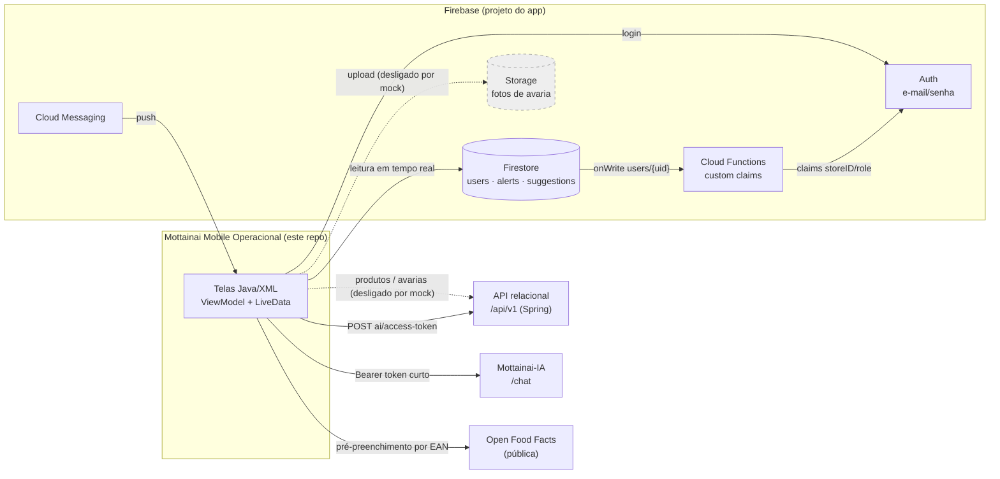
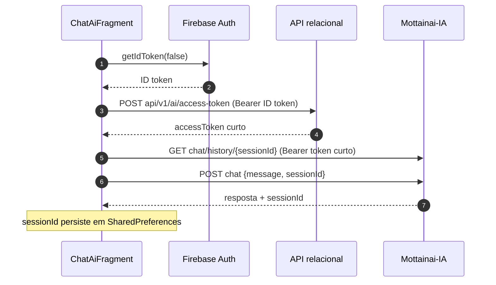
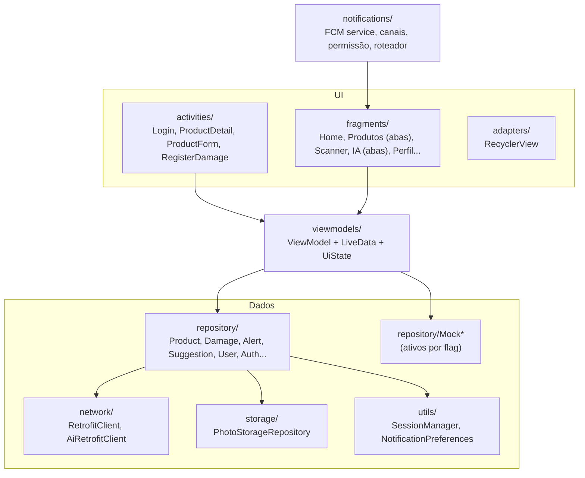
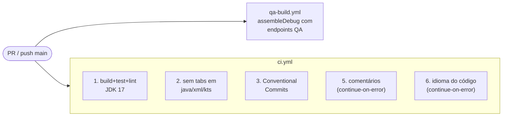

<div align="center">

# Mottainai Mobile Operacional

**App Android usado pela equipe interna da loja no Mottainai: gestão preditiva de estoque para pequenos e médios varejos**

*Catálogo de produtos, leitura de código de barras, registro de avarias, inventário, alertas e sugestões da IA e chat operacional, com acesso por perfil (estoquista, gerente e dono).*

<br/>

[](app/build.gradle.kts)
[-ED8B00?style=for-the-badge&logo=openjdk&logoColor=white)](app/build.gradle.kts)
[](app/build.gradle.kts)
[](gradle/wrapper/gradle-wrapper.properties)

[](gradle/libs.versions.toml)
[](app/build.gradle.kts)
[](app/build.gradle.kts)
[](app/build.gradle.kts)
[](.github/workflows/ci.yml)
[-orange?style=flat-square)](#11-status-limitações-e-roadmap)

<br/>

[Visão geral](#1-visão-geral) •
[Ecossistema](#2-papel-no-ecossistema) •
[Funcionalidades](#3-funcionalidades-e-estado-real) •
[Arquitetura](#4-arquitetura) •
[Tecnologias](#5-tecnologias) •
[Integrações](#7-integrações-e-contratos) •
[Como rodar](#8-configuração-e-execução) •
[CI](#9-testes-e-integração-contínua) •
[Segurança](#10-segurança-e-riscos)

</div>

---

## 1. Visão geral

O **Mottainai** (もったいない, *"que desperdício"*) é um sistema de gestão preditiva de estoque para pequenos e médios varejos, desenvolvido como projeto interdisciplinar (o README original cita o Instituto Germinare, 2026). Este repositório contém o **app operacional Android**, escrito em **Java com Views XML**, usado pelo time da loja no dia a dia.

| | Princípio | Como aparece no código |
|---|---|---|
| **1** | **Perfil vem do login, não de escolha manual** | `role` e `storeID` saem do documento `users/{uid}` no Firestore **e** precisam estar nas *custom claims* do token Firebase; sem isso o login é bloqueado (`LoginActivity`) |
| **2** | **Isolamento por loja** | Consultas e regras do Firestore filtram por `storeID` (`AlertRepository`, `SuggestionRepository`, `firestore.rules`) |
| **3** | **Nada de sucesso simulado onde não há contrato** | Aprovar/recusar sugestão, convidar membro e sincronizar token FCM mostram aviso de "pendente" em vez de fingir persistência |
| **4** | **HTTP só em debug** | `usesCleartextTraffic` existe apenas em `app/src/debug/AndroidManifest.xml`; o `release` usa URLs HTTPS por padrão |
| **5** | **Token da IA de escopo curto** | O chat troca o ID token Firebase por um token curto na API relacional antes de chamar a IA |

> [!WARNING]
> Na `main` atual, **produtos, avarias, inventário e fornecedores rodam em modo mock/local** (`Constants.USE_MOCK_REPOSITORY`, `USE_MOCK_DAMAGE`, `USE_MOCK_INVENTORY` = `true`). As integrações reais com a API existem no código, mas estão desligadas por flag de compilação.

---

## 2. Papel no ecossistema



| Perfil | O que o app libera (conforme `RoleHelper` e telas) |
|---|---|
| **Estoquista** | Produtos, scanner, avarias, inventário, alertas, chat. **Não** vê sugestões; fornecedores só leitura |
| **Gerente** | Tudo do estoquista + cadastro/edição de produto, sugestões, manutenção de fornecedores |
| **Dono** | Tudo do gerente + área de configuração/equipe |

> [!NOTE]
> O app **não** acessa banco relacional diretamente. Ele usa Firebase (Auth, Firestore, Storage, FCM) e APIs HTTP. Os nomes "Mottainai-IA" e "API relacional" vêm de comentários do código e de `docs/`; os contratos do lado servidor **não foram verificados** nesta análise.

---

## 3. Funcionalidades e estado real

| Funcionalidade | Telas | Fonte de dados na `main` | Estado |
|---|---|---|:---:|
| Login e sessão | `LoginActivity`, `ProfileFragment` | Firebase Auth + Firestore `users` + claims |  |
| Home (contadores) | `HomeFragment` | Firestore `alerts`/`suggestions`; métricas financeiras exibem `—` |  |
| Catálogo / busca / detalhe | `ProductCatalogFragment`, `ProductDetailActivity` | `MockProductRepository` (7 produtos em memória) |  |
| Cadastro/edição de produto | `ProductFormActivity` | Mock + Open Food Facts para pré-preencher pelo código |  |
| Scanner de código de barras | `ScannerFragment` | CameraX + ZXing; busca no repositório de produtos (mock) |  |
| Registro de avaria com foto | `RegisterDamageFragment/Activity`, `DamageSuccessFragment` | Mock em memória; upload devolve URL fictícia |  |
| Inventário (contagem x sistema) | `InventoryFragment` | `MockInventoryRepository`, só em memória |  |
| Fornecedores | `SuppliersFragment`, `New/EditSupplierFragment` | `MockSupplierRepository` em `SharedPreferences`, por loja |  |
| Alertas da IA (CRITICO/ATENCAO/MONITOR) | `IaAlertsFragment` | Firestore `alerts` (tempo real) |  |
| Sugestões da IA | `IaAlertsFragment`, `ApproveSuggestionFragment` | Leitura Firestore; **aprovar/recusar só mostra Toast** |  |
| Chat operacional com IA | `ChatAiFragment` (aba da área IA) | API (`ai/access-token`) + IA (`chat`, `chat/history`) |  |
| Configurações / regras | `ConfigFragment` | `NotificationPreferences` local |  |
| Convidar/editar membro | `InviteMemberFragment`, `EditMemberFragment` | Sem endpoint; só UI |  |
| Push notifications | `MottainaiFirebaseMessagingService` | FCM recebido e roteado; token **não** é enviado a nenhum backend |  |

<details>
<summary><b>Scanner: como a leitura funciona</b></summary>

<br/>

1. `ScannerFragment` liga `Preview` + `ImageAnalysis` do CameraX ao ciclo de vida.
2. `BarcodeAnalyzer` decodifica o plano Y de cada frame com o `MultiFormatReader` do ZXing, tratando rotação.
3. Formatos habilitados: `EAN_13`, `EAN_8`, `UPC_A`, `UPC_E`, `CODE_128`, `CODE_39`, `QR_CODE`, `DATA_MATRIX`.
4. `ScannerViewModel` aplica *debounce* de 2 s para o mesmo código e bloqueia novas leituras enquanto busca.
5. O código é procurado via `fetchProductByBarcode` (mock na `main`; em modo real, `GET api/v1/products/barcode/{barcode}`).
6. Há feedback sonoro/tátil e o card de resultado some após 10 s (`Constants.SCANNER_RESULT_DISMISS_MS`).

</details>

<details>
<summary><b>Chat com IA: troca de token</b></summary>

<br/>



Erros 401 pedem novo login; 403 indica falta de permissão; há botão de *retry* para envio e histórico.

</details>

---

## 4. Arquitetura

Arquitetura em camadas no estilo **MVVM simples**, sem injeção de dependência (repositórios são instanciados nos ViewModels).



### Navegação

Bottom navigation (`res/menu/bottom_nav_menu.xml`) + Navigation Component (`res/navigation/nav_graph.xml`), com FAB central para o scanner:

| Aba | Destino | Sub-áreas |
|---|---|---|
| Home | `homeFragment` | Resumo de alertas e aprovações |
| Produtos | `productsListFragment` | Abas **Lista**, **Inventário**, **Fornecedores** (ViewPager2) |
| *(FAB)* | `scannerFragment` | Scanner → registro de avaria → sucesso |
| IA | `iaAlertsFragment` | Abas **Alertas**, **Sugestões**, **Chat** |
| Perfil | `profileFragment` | Configurações → convidar/editar membro |

`LoginActivity` é a *launcher*; `MainActivity` valida sessão Firebase + perfil completo e redireciona ao login se faltar algo.

---

## 5. Tecnologias

<table>
<tr>
<td align="center" width="140"><br/><b>Android SDK</b><br/><sub>compile/target 36<br/>min 26</sub></td>
<td align="center" width="140"><br/><b>Java</b><br/><sub>source/target 11<br/>(CI usa JDK 17)</sub></td>
<td align="center" width="140"><br/><b>Gradle 9.1.0</b><br/><sub>Kotlin DSL<br/>AGP 9.0.1</sub></td>
<td align="center" width="140"><br/><b>Firebase</b><br/><sub>Auth, Firestore,<br/>Storage, FCM, Analytics</sub></td>
</tr>
<tr>
<td align="center" width="140"><br/><b>Retrofit + OkHttp</b><br/><sub>2.11.0 / 4.12.0<br/>Gson converter</sub></td>
<td align="center" width="140"><br/><b>CameraX + ZXing</b><br/><sub>1.4.2 / embedded 4.3.0<br/>leitura de códigos</sub></td>
<td align="center" width="140"><br/><b>Material + Jetpack</b><br/><sub>Navigation 2.8.9<br/>Lifecycle 2.8.7</sub></td>
<td align="center" width="140"><br/><b>Cloud Functions</b><br/><sub>Node 20<br/>custom claims</sub></td>
</tr>
</table>

<details>
<summary><b>Dependências declaradas (versões observadas nos arquivos)</b></summary>

<br/>

| Grupo | Artefato | Versão | Onde |
|---|---|---|---|
| Plugin | `com.android.application` | 9.0.1 | `libs.versions.toml` |
| Plugin | `com.google.gms.google-services` | 4.5.0 | `build.gradle.kts` (raiz) |
| AndroidX | appcompat / activity / constraintlayout | 1.7.1 / 1.13.0 / 2.2.1 | `libs.versions.toml` |
| Material | `com.google.android.material:material` | 1.14.0 **e** 1.12.0 | catálogo **e** declaração direta (duplicado) |
| Firebase | `firebase-bom` (analytics, auth, firestore, storage, messaging) | 34.16.0 | `app/build.gradle.kts` |
| Rede | retrofit / converter-gson | 2.11.0 | `app/build.gradle.kts` |
| Rede | okhttp / logging-interceptor | 4.12.0 | `app/build.gradle.kts` |
| Câmera | camera-core / camera2 / lifecycle / view | 1.4.2 | `app/build.gradle.kts` |
| Leitura | `zxing-android-embedded` | 4.3.0 | `app/build.gradle.kts` |
| Imagem | Glide (+ compiler) | 4.16.0 | `app/build.gradle.kts` |
| Jetpack | recyclerview / lifecycle / navigation / viewpager2 | 1.3.2 / 2.8.7 / 2.8.9 / 1.1.0 | `app/build.gradle.kts` |
| Mapa | `osmdroid-android` | 6.1.18 | declarado, **sem uso no código Java** |
| Testes | junit / ext-junit / espresso | 4.13.2 / 1.3.0 / 3.7.0 | `libs.versions.toml` |
| Functions | firebase-admin / firebase-functions | `^12.0.0` / `^5.0.0` | `functions/package.json` (faixas, não fixas) |

</details>

---

## 6. Estrutura do repositório

```text
Mottainai-Mobile-Operacional/
├── .github/workflows/
│   ├── ci.yml                    # build+teste+lint, indentação, commits, avisos de idioma
│   └── qa-build.yml              # assembleDebug apontando para endpoints QA do emulador
├── app/
│   ├── build.gradle.kts          # SDKs, BuildConfig API_BASE_URL/IA_BASE_URL, dependências
│   ├── google-services.json      # config Firebase do app (versionada, ver Segurança)
│   └── src/
│       ├── main/java/com/mottainai/operacional/
│       │   ├── activities/       # Login, ProductDetail, ProductForm, RegisterDamage
│       │   ├── fragments/        # 17 fragments (Home, Scanner, IA, Perfil, Fornecedores...)
│       │   ├── viewmodels/       # ViewModels + UiStates
│       │   ├── repository/       # repositórios reais e Mock*
│       │   ├── network/          # Retrofit: ApiService, AiApiService, OpenFoodFacts
│       │   ├── notifications/    # FCM service, canais, permissão, roteamento
│       │   ├── scanner/          # BarcodeAnalyzer (ZXing)
│       │   ├── storage/          # upload de foto (Firebase Storage)
│       │   ├── models/ adapters/ utils/
│       │   └── MainActivity.java
│       ├── main/res/             # 29 layouts, nav_graph, menu, temas claro/escuro, dimens por largura
│       ├── debug/AndroidManifest.xml   # libera cleartext só no debug
│       ├── test/                 # ExampleUnitTest, AppLocalesTest
│       └── androidTest/          # ExampleInstrumentedTest
├── functions/                    # Cloud Functions (custom claims) + script de backfill
├── docs/                         # MOBILE-09 notificações, MOBILE-10 perfil/fornecedores, QA
├── firebase.json · .firebaserc · firestore.rules
├── gradle/ (libs.versions.toml, wrapper) · gradlew · gradlew.bat
└── settings.gradle.kts · build.gradle.kts · gradle.properties
```

---

## 7. Integrações e contratos

### API relacional (`BuildConfig.API_BASE_URL`, `network/ApiService.java`)

| Método | Rota | Uso no app | Ativo na `main`? |
|---|---|---|:---:|
| `GET` | `api/v1/products?page&size&sort&search` | lista/busca | não (mock) |
| `GET` | `api/v1/products/{id}` | detalhe | não (mock) |
| `GET` | `api/v1/products/barcode/{barcode}` | scanner | não (mock) |
| `POST` / `PUT` | `api/v1/products` / `api/v1/products/{id}` | cadastro/edição (`ProductUpsertRequest`) | não (mock) |
| `POST` | `api/v1/damages` | avaria — comentário diz *"contrato pendente"* | não (mock) |
| `GET` | `api/v1/alerts?store_id=` / `api/v1/suggestions?store_id=` | declarados, mas alertas/sugestões vêm do Firestore | não usados |
| `POST` | `api/v1/ai/access-token` | token curto para a IA | **sim** |

O `RetrofitClient` adiciona `Authorization: Bearer <ID token Firebase>` (lido do `SessionManager`) e redige esse header nos logs de debug.

> [!IMPORTANT]
> O mapeamento `ProductResponse → Product` preenche quantidade, estoque mínimo, lote, validade e loja com valores vazios/zero (`TODO contrato pendente` em `ProductRepository`). Ligar `USE_MOCK_REPOSITORY=false` hoje faria telas de estoque exibirem zeros.

### Mottainai-IA (`BuildConfig.IA_BASE_URL`, `network/AiApiService.java`)

| Método | Rota | Corpo |
|---|---|---|
| `POST` | `chat` | `{ message, sessionId }` |
| `GET` | `chat/history/{sessionId}` | — |

### Firebase

| Serviço | Uso |
|---|---|
| Auth | `signInWithEmailAndPassword`; exige claims `storeID` e `role` no ID token |
| Firestore | `users/{uid}` (nome, role, storeID), `alerts` (filtro `storeID` + `days <= 7` na Home), `suggestions` (`storeID` + `status == "pending"`) |
| Storage | `damages/{storeId}/{productId}/{uuid}.jpg` — só quando `USE_MOCK_DAMAGE=false` |
| FCM | tipos roteados: `product`, `damage`, `alert`, `suggestion`, `inventory`, `home`; destino validado pelo papel |
| Functions | `setUserClaims` (criação de usuário) e `updateUserClaims` (`users/{uid}` onWrite) copiam `storeID`/`role` (role em MAIÚSCULAS) para as claims |

### Open Food Facts

`GET https://world.openfoodfacts.org/api/v0/product/{barcode}.json`, usado por `ProductFormActivity` para sugerir nome/marca no cadastro. API pública, sem credencial.

<details>
<summary><b>Contratos ainda inexistentes, documentados em <code>docs/</code></b></summary>

<br/>

- `POST /api/v1/devices/tokens` e `DELETE /api/v1/devices/tokens/current` — registro/remoção do token FCM (`docs/MOBILE-09-NOTIFICATIONS-CONTRACT.md`). O app guarda o token localmente como "pendente de sincronização".
- Upload de avatar — sem contrato (`docs/MOBILE-10-PROFILE.md`).
- `/api/v1/suppliers` existe na API relacional segundo `docs/MOBILE-10-SUPPLIERS.md`, mas o app não usa porque exige `addressId` e a tela não coleta endereço.
- Aprovar/recusar sugestão e convidar membro — sem endpoint de escrita.

</details>

---

## 8. Configuração e execução

### Pré-requisitos

- [ ] Android Studio compatível com **AGP 9.0.1** / **Gradle 9.1.0** (versão mínima do Studio **não confirmada no repositório**)
- [ ] **JDK 17** (o que a CI usa)
- [ ] Emulador ou dispositivo com **Android 8.0 (API 26)** ou superior
- [ ] Usuário no Firebase Auth com documento `users/{uid}` contendo `name`, `role`, `storeID` **e** custom claims aplicadas

### Variáveis de build

Lidas de `-P` (Gradle) ou do `local.properties` (ignorado pelo Git):

| Propriedade | Build | Padrão no código |
|---|---|---|
| `apiBaseUrl` | debug | URL HTTPS de produção do projeto |
| `iaBaseUrl` | debug | `http://10.0.2.2:8000/` |
| `releaseApiBaseUrl` | release | URL HTTPS de produção do projeto |
| `releaseIaBaseUrl` | release | URL HTTPS da IA |

> [!CAUTION]
> Se `apiBaseUrl` não for definido, o **debug aponta para a URL de produção** da API. Para desenvolvimento ou QA, defina sempre os endpoints locais.

### Rodar contra a stack QA local (conforme `docs/QA-ENVIRONMENT.md`)

```properties
# local.properties (não versionado)
apiBaseUrl=http://10.0.2.2:18080/
iaBaseUrl=http://10.0.2.2:18000/
```

```bash
./gradlew assembleDebug
```

Ou, sem editar arquivos, como a CI faz:

```bash
./gradlew assembleDebug -PapiBaseUrl=http://10.0.2.2:18080/ -PiaBaseUrl=http://10.0.2.2:18000/
```

`10.0.2.2` só funciona no emulador. A doc recomenda checar `/actuator/health` (API) e `/readyz` (IA) antes de testar.

### Comandos usados pela CI

```bash
./gradlew testDebugUnitTest lintDebug assembleDebug --no-daemon --stacktrace
```

### Cloud Functions (opcional)

```bash
npm --prefix functions run set-claims   # backfill de claims; exige GOOGLE_APPLICATION_CREDENTIALS fora do repo
```

Os scripts `serve`, `deploy` e `logs` existem em `functions/package.json`; deploy afeta o projeto Firebase real.

> [!NOTE]
> Não há `release` assinado configurado (sem `signingConfigs`) e `isMinifyEnabled = false`.

---

## 9. Testes e integração contínua

### Testes

| Tipo | Arquivo | Cobertura real |
|---|---|---|
| Unitário | `AppLocalesTest` | verifica a tag de idioma `pt-BR` |
| Unitário | `ExampleUnitTest` | template (`2 + 2`) |
| Instrumentado | `ExampleInstrumentedTest` | template |

> [!WARNING]
> Não há testes de ViewModels, repositórios, scanner, roteamento de notificação ou regras do Firestore.

### Workflows



- Actions fixadas por versão em `ci.yml` (`checkout@v4.2.2`, `setup-java@v4.7.1`); `qa-build.yml` usa tags flutuantes `@v4`.
- Os jobs de idioma só emitem avisos; não bloqueiam o merge.
- Nenhum artefato (APK) é publicado pelos workflows.

---

## 10. Segurança e riscos

| # | Risco | Evidência | Sugestão |
|:---:|---|---|---|
| 1 | **Config Firebase versionada** | `app/google-services.json` e `.firebaserc` estão no Git; o JSON tem campo `api_key` (valor não reproduzido aqui) | Chave de cliente Firebase não é segredo de servidor, mas deve ter restrição por pacote/SHA no Console e App Check. Separar projeto QA como pede `docs/QA-ENVIRONMENT.md` |
| 2 | **Token em `SharedPreferences` sem criptografia + backup ligado** | `SessionManager` guarda o ID token; `allowBackup="true"` com `backup_rules.xml`/`data_extraction_rules.xml` ainda no template | Excluir `mottainai_session` do backup ou usar armazenamento cifrado; o token expira, mas a sessão inteira vai para backup |
| 3 | **Regras do Firestore permissivas para escrita** | Em `alerts`, `suggestions`, `damages`, `inventory`, qualquer usuário da loja pode criar/editar/apagar, sem checar papel | Restringir escrita a backend/Admin SDK ou a `GERENTE`/`DONO` |
| 4 | **Debug aponta para produção por padrão** | Fallback de `apiBaseUrl` no debug é a URL de produção | Usar fallback local/QA no debug |
| 5 | **Dupla fonte de papel/loja** | Firestore `users` **e** claims; Functions grava `role` em MAIÚSCULAS e o app compara em minúsculas (normalizado por `RoleHelper`) | Tratar claims como fonte única; manter normalização testada |
| 6 | **Dependências não fixadas nas Functions** | `^12.0.0`, `^5.0.0`; sem lockfile auditado nesta análise | Fixar versões exatas |

---

## 11. Status, limitações e roadmap

### Divergências entre README original e código

| README original diz | Código na `main` mostra |
|---|---|
| Endpoints `POST /auth/login`, `GET /auth/me`, `POST /chat` na API | Login é Firebase Auth; não há `/auth/*`; chat vai para a IA em `chat` após `api/v1/ai/access-token` |
| `GET /products/expiring`, `PUT /suggestions/{id}/approve|reject` | Não existem no `ApiService` |
| Chat com "Agente Funcionário" e "Agente Dono" | `AiChatRequest` envia só `message` e `sessionId`; não há seleção de agente no app |
| Integração ViaCEP | Nenhuma referência a ViaCEP no código |
| "repository → chamadas à API REST" | Alertas/sugestões/usuário vêm do Firestore; produtos/avarias/inventário/fornecedores estão em mock |
| "Adicione o `google-services.json`" | O arquivo já está versionado |

### Status

| Item | Status |
|---|:---:|
| Login Firebase com claims e perfil |  |
| Alertas e leitura de sugestões (Firestore) |  |
| Chat com IA via token curto |  |
| Scanner CameraX/ZXing |  |
| Recepção e roteamento FCM |  |
| Produtos/avarias contra a API real |  |
| Inventário com backend |  |
| Fornecedores via `/api/v1/suppliers` |  |
| Aprovar/recusar sugestão, convite de membro |  |
| Sincronização do token FCM |  |

### Roadmap (derivado de TODOs, flags e `docs/`)

- [x] Login por perfil com claims (MOBILE-10)
- [x] Scanner contínuo (MOBILE-04)
- [x] Fundação de notificações FCM (MOBILE-09)
- [x] Chat operacional conectado à IA
- [ ] Contrato de inventário em `api/v1/products` (quantidade, mínimo, lote, validade) e desligar `USE_MOCK_REPOSITORY`
- [ ] `POST api/v1/damages` + upload real no Storage (`USE_MOCK_DAMAGE=false`)
- [ ] Sessões de inventário no backend (`USE_MOCK_INVENTORY=false`)
- [ ] Endpoints de decisão de sugestão e de equipe
- [ ] `devices/tokens` para FCM
- [ ] Projeto Firebase dedicado a QA
- [ ] Remover dependências sem uso (`osmdroid`, `firebase-firestore` duplicado no catálogo) e a declaração duplicada do Material

<details>
<summary><b>Pontos a decidir</b></summary>

<br/>

- **Firestore x API para alertas/sugestões:** o `ApiService` declara `api/v1/alerts` e `api/v1/suggestions`, mas o app lê do Firestore. Manter duas fontes cria risco de divergência; vale definir uma oficial.
- **Mock como flag de compilação:** as flags são `static final` em `Constants`; trocar exige recompilar. Um `buildConfigField` por build type permitiria um build QA integrado sem tocar no código.

</details>

---

## 12. Rastreabilidade da análise

| Item | Valor |
|---|---|
| Repositório | `Mottainai-One/Mottainai-Mobile-Operacional` |
| Branch analisada | `main` (única branch remota no clone) |
| Commit | `a04b79a` — *ci: build Android app against QA endpoints* (2026-10-19) |
| Data da análise | 2026-10-27 |
| Método | Leitura estática do clone local; **nenhum build, teste ou execução** foi feito |

<details>
<summary><b>Arquivos consultados</b></summary>

<br/>

`README.md`, `build.gradle.kts`, `settings.gradle.kts`, `gradle.properties`, `gradle/libs.versions.toml`, `gradle/wrapper/gradle-wrapper.properties`, `app/build.gradle.kts`, `app/src/main/AndroidManifest.xml`, `app/src/debug/AndroidManifest.xml`, `app/src/main/res/menu/bottom_nav_menu.xml`, `app/src/main/res/navigation/nav_graph.xml`, `app/src/main/res/xml/backup_rules.xml`, `app/src/main/res/xml/data_extraction_rules.xml`, `app/google-services.json` (só nomes de campos), `.firebaserc` (só estrutura), `.gitignore`, `app/.gitignore`, `firebase.json`, `firestore.rules`, `functions/package.json`, `functions/index.js`, `functions/scripts/set-claims.js`, `docs/MOBILE-09-NOTIFICATIONS-CONTRACT.md`, `docs/MOBILE-10-PROFILE.md`, `docs/MOBILE-10-SUPPLIERS.md`, `docs/QA-ENVIRONMENT.md`, `.github/workflows/ci.yml`, `.github/workflows/qa-build.yml`, `network/*.java`, `utils/Constants.java`, `utils/SessionManager.java`, `utils/RoleHelper.java`, `repository/AuthRepository.java`, `UserRepository.java`, `ProductRepository.java`, `MockProductRepository.java`, `DamageRepository.java`, `AlertRepository.java`, `SuggestionRepository.java`, `storage/PhotoStorageRepository.java`, `scanner/BarcodeAnalyzer.java`, `viewmodels/ScannerViewModel.java`, `HomeViewModel.java`, `InventoryViewModel.java`, `activities/LoginActivity.java`, `MainActivity.java`, `fragments/ChatAiFragment.java`, `ScannerFragment.java`, `IaAlertsFragment.java`, `HomeFragment.java`, `ApproveSuggestionFragment.java`, `ConfigFragment.java`, `InviteMemberFragment.java`, `InventoryFragment.java`, `ProductsListFragment.java`, `notifications/NotificationRouter.java`, testes em `app/src/test` e `app/src/androidTest`.

</details>

> [!NOTE]
> Itens marcados como "não confirmado no repositório" ou dependentes de servidor (contratos da API relacional e da IA, dados reais no Firestore, configuração do Console Firebase) não foram verificados. Badges refletem apenas versões lidas nos arquivos, não status de pipeline.

---

<div align="center">

**Mottainai** · *menos desperdício, mais inteligência no estoque*

<sub>Parte do ecossistema <a href="https://github.com/Mottainai-One">Mottainai-One</a></sub>

</div>
